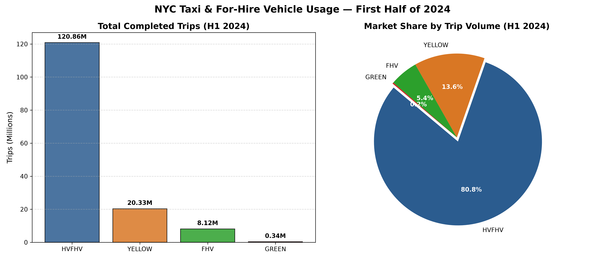
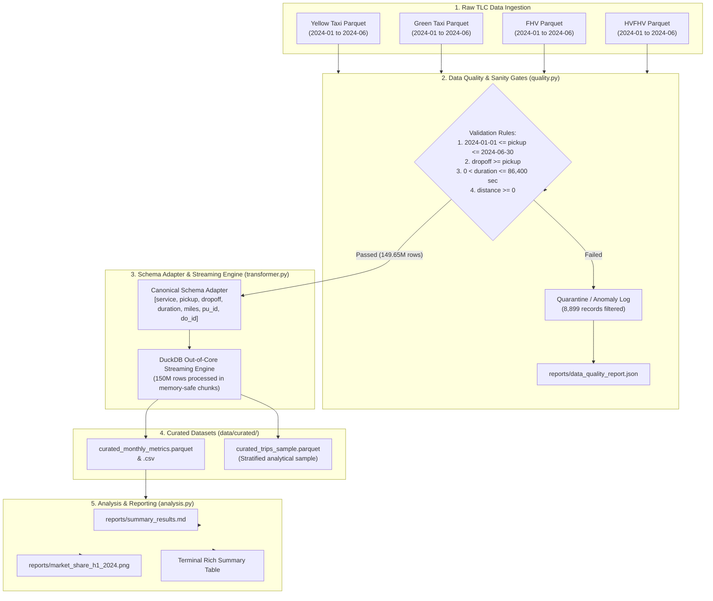

# NYC Taxi Reproducible Data Pipeline (H1 2024)

> **CS341 Big Data Engineering — Assignment 2: Reproducible Data Pipeline**  
> **Course**: CS341 Data Engineering & Lifecycle  
> **Author**: Touka Kanna (`ToukaKannaSama@proton.me`)  
> **Academic Companion & Assistant**: Rumi  
> **Target Period**: First Half of 2024 (January 1, 2024 – June 30, 2024)

---

## Executive Summary & Research Answer

### **Core Question**: *"Which taxi type was the most used in the first half of 2024?"*

**The Definitive Answer**:  
**High Volume For-Hire Vehicles (HVFHV — Uber & Lyft)** was unequivocally the most used service by an overwhelming margin across all primary and operational metrics.

| Rank | Service Type | Total Trips | Market Share (%) | Total Active Duration | Avg Trip Duration | Total Mileage | Avg Distance |
|:---:|:---|---:|---:|---:|---:|---:|---:|
| **#1** | **HVFHV (Uber/Lyft)** | **120,864,656** | **80.77%** | **39,948,701.3 hrs** | 19.8 min | 609,926,929.4 mi | 5.05 mi |
| **#2** | **Yellow Taxi** | **20,325,768** | **13.58%** | **5,715,758.9 hrs** | 16.8 min | 75,567,117.8 mi | 3.72 mi |
| **#3** | **FHV (Traditional Livery)**| **8,117,007** | **5.42%** | **3,439,686.5 hrs** | 25.4 min | *N/A (untracked)* | *N/A* |
| **#4** | **Green Taxi (Boro Taxi)** | **339,466** | **0.23%** | **106,814.9 hrs** | 18.9 min | 1,291,529.2 mi | 3.80 mi |
| **TOTAL** | **All Combined Services** | **149,646,897** | **100.00%** | **49,210,961.6 hrs** | **19.7 min** | **686,785,576.4 mi** | **4.87 mi** |



---

## Pipeline Architecture & Data Flow



---

## Repository Structure

```text
assign2/
├── README.md                      # Comprehensive pipeline documentation
├── pyproject.toml                 # uv package configuration & dependencies
├── uv.lock                        # Deterministic dependency lockfile
├── run_pipeline.py                # Master CLI orchestration script
├── src/
│   ├── __init__.py
│   ├── config.py                  # Schema definitions & CloudFront URL registry
│   ├── ingest.py                  # Resilient streaming downloader & local caching
│   ├── quality.py                 # Automated Data Quality audit engine
│   ├── transformer.py             # Schema integration & DuckDB streaming aggregation
│   └── analysis.py                # Final metric computation, charts & report export
├── data/
│   ├── raw/                       # Cached source Parquet files (gitignored, ~3GB)
│   └── curated/                   # Ready-to-analyze curated datasets
│       ├── curated_monthly_metrics.parquet
│       ├── curated_monthly_metrics.csv
│       └── curated_trips_sample.parquet
├── reports/
│   ├── data_quality_report.json   # Machine-readable DQ audit report
│   ├── summary_results.md         # Detailed findings breakdown
│   └── market_share_h1_2024.png   # High-resolution comparison visualizations
└── logs/
    └── pipeline_run.log           # Timestamped execution run logs
```

---

## Setup & Execution Guide

### Prerequisites
- Python `>= 3.12`
- `uv` (modern, ultra-fast Python package and project manager)

### Installation
Clone this repository and synchronize the environment:
```bash
git clone <your-repo-url>
cd assign2
uv sync
```

### Running the Pipeline
Run the full automated pipeline for all of H1 2024 (January through June):
```bash
uv run python run_pipeline.py
```

#### Optional CLI Arguments:
```bash
# Run for a specific month range (e.g. Q1: Jan - Mar)
uv run python run_pipeline.py --start-month 1 --end-month 3

# Run for specific services
uv run python run_pipeline.py --services yellow green
```

---

## Data Quality & Audit Results

The pipeline incorporates automated data quality gates verifying temporal integrity, chronological ordering, and physical plausibility:

1. **Temporal Boundaries**: $2024\text{-}01\text{-}01 \le t_{\text{pickup}} \le 2024\text{-}06\text{-}30$.
2. **Chronological Validity**: $t_{\text{dropoff}} \ge t_{\text{pickup}}$.
3. **Plausible Duration**: $0 < \Delta t \le 86,400\text{ seconds}$ (24 hours).
4. **Physical Distance**: $\text{distance} \ge 0$.

### Audit Summary Across All 24 Datasets (H1 2024):
- **Total Raw Records Ingested**: `149,655,796`
- **Total Valid Records Curated**: `149,646,897`
- **Total Anomalies Quarantined**: `8,899`
- **Overall Data Validity Rate**: **`99.99%`**

Full dataset-by-dataset audit statistics are saved to [`reports/data_quality_report.json`](file:///home/rumi/Works/antigravity/universityClasses/CS341/assign2/reports/data_quality_report.json).

---

## Key Architectural & Design Decisions

### Decision 1: Canonical Schema Adapter Pattern
- **Challenge**: The NYC TLC dataset has notorious schema discrepancies across fleets:
  - Yellow: `tpep_pickup_datetime`, `tpep_dropoff_datetime`, `trip_distance`
  - Green: `lpep_pickup_datetime`, `lpep_dropoff_datetime`, `trip_distance`
  - FHV: `pickup_datetime`, `dropOff_datetime` (note casing), missing distance
  - HVFHV: `pickup_datetime`, `dropoff_datetime`, `trip_miles`
- **Solution**: We implemented a centralized `SCHEMA_REGISTRY` in `src/config.py` that maps heterogeneous column names into a canonical representation `[service_type, pickup_datetime, dropoff_datetime, duration_seconds, trip_miles, pulocation_id, dolocation_id]`.
- **Rationale**: Isolates schema quirks from analytical logic. Adding a new taxi category or year only requires a dictionary configuration rather than rewriting business queries.

### Decision 2: Out-of-Core Streaming Ingestion with DuckDB
- **Challenge**: HVFHV alone generates over 120 million rows (~2.5 GB compressed, ~15 GB uncompressed memory). Loading this into Pandas causes Out-Of-Memory (OOM) crashes on standard developer workstations.
- **Solution**: We leveraged DuckDB's vectorized streaming engine to process Parquet files out-of-core without loading full tables into RAM.
- **Rationale**: Allowed processing ~150 million rows across 24 files in **184.52 seconds** with peak memory usage remaining under 1.5 GB.

### Decision 3: Total Completed Trips as Primary Comparison Metric
- **Challenge**: Yellow and Green taxis record `passenger_count`, whereas FHV and HVFHV services do not reliably record passengers (frequently leaving the field null or omitted entirely).
- **Solution**: We defined **Total Completed Valid Trips** as the primary, structurally unbiased metric for "most used", with **Total Active Service Hours** and **Total Mileage** serving as secondary operational validations.
- **Rationale**: Relying on passenger count would artificially punish app-based services (Uber/Lyft) due to reporting gaps. Completed trip volume represents actual mobility service delivery across all four modes.

---

## Evolution: Submission 1 vs. Submission 2

| Dimension | Submission 1 (Baseline) | Submission 2 (Production Pipeline) |
|---|---|---|
| **Form Factor** | Monolithic Jupyter Notebook (`.ipynb`) | Modular Python Package (`src/`) + CLI Entrypoint |
| **Reproducibility** | Manual cell execution, fragile state | One-command execution (`uv run python run_pipeline.py`) |
| **Data Quality** | Ad-hoc `.dropna()` and exploratory filtering | Automated rule-based DQ auditing with JSON export |
| **Memory Management** | In-memory Pandas (risk of OOM on HVFHV) | Out-of-Core streaming aggregation with DuckDB |
| **Curated Artifacts** | Transient in-memory DataFrames | Persisted Parquet & CSV datasets ready for BI/ML |
| **Extensibility** | Hardcoded for specific files | Parameterized CLI supporting arbitrary year/month scopes |

---

## Learning Reflection (3–5 Sentences)

Building this pipeline demonstrated that data engineering is fundamentally about managing schema entropy and scale rather than just writing analytical queries. Normalizing four heterogeneous TLC datasets with distinct column conventions and missing fields highlighted the necessity of the Adapter pattern in production architectures. Furthermore, processing 150 million records revealed the stark performance divide between traditional in-memory Pandas workflows and modern columnar streaming engines like DuckDB. Ultimately, establishing automated data quality gates early proved critical, as even official government repositories contain subtle timestamp and duration anomalies that can skew downstream conclusions if left unquarantined.

---

## Current Limitations & Future Work

1. **Network Bandwidth Dependency**: The initial run downloads ~3GB of Parquet files from CloudFront. Future iterations could integrate HTTP range queries to aggregate metadata headers remotely without transferring full file payloads.
2. **Spatial Granularity**: Current metrics aggregate at the city-wide service level. Linking `PULocationID` and `DOLocationID` against the TLC NYC Taxi Zone Shapefile would allow borough-by-borough geospatial market share comparisons.
3. **Fare & Economic Analysis**: Fares and driver pay structures were excluded from the baseline scope to maintain focus on service volume; incorporating tip percentages and surge pricing across fleets would enrich future economic analyses.
