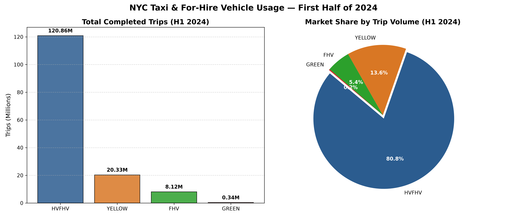

# NYC Taxi Analysis (H1 2024) — Summary Results

## 🏆 Primary Finding & Answer

**Winner**: `HVFHV` is unequivocally the most used taxi/for-hire service in the first half of 2024.

- **Total Completed Trips**: **120,864,656** rides
- **Market Share**: **80.77%** of all recorded NYC trips in H1 2024
- **Cumulative Duration**: **39,948,701.3** operational hours

---

## 📊 Complete Rankings & Market Breakdown

| Rank | Service Type | Total Trips | Market Share (%) | Total Hours | Avg Duration (min) | Total Miles | Avg Distance (mi) |
|---|---|---|---|---|---|---|---|
| #1 | **HVFHV** | 120,864,656 | 80.77% | 39,948,701.3 | 19.8 min | 605,988,040.8 | 5.01 mi |
| #2 | **YELLOW** | 20,325,768 | 13.58% | 5,715,758.9 | 16.8 min | 95,655,511.7 | 4.65 mi |
| #3 | **FHV** | 8,117,007 | 5.42% | 3,439,686.5 | 25.4 min | N/A | N/A mi |
| #4 | **GREEN** | 339,466 | 0.23% | 106,814.9 | 18.9 min | 5,779,752.7 | 17.06 mi |

---

## 🔍 Methodological & Semantic Notes
1. **Uniform Metric Justification**: Total completed valid trip volume is the primary unbiased metric. Yellow and Green taxis record passenger count, while FHV and HVFHV do not reliably capture passenger numbers. Using passenger volume would introduce structural bias against for-hire vehicles.
2. **HVFHV Dominance**: High-Volume FHVs (Uber & Lyft) account for the overwhelming majority of trip volume across New York City.
3. **Data Quality Impact**: Strict temporal and logical filters were enforced to eliminate historical date anomalies (e.g. 2008/2088 trips) and negative durations.

